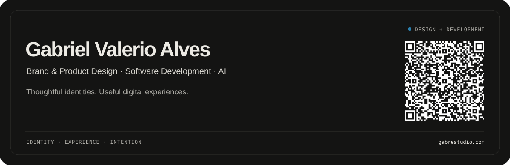
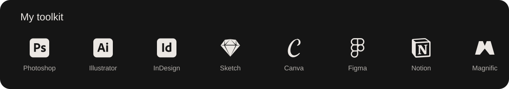

I’m **Gabriel Valerio Alves**, a Brand & UI/UX Designer building digital products through **Gabre Studio**. My work connects visual identity, user experience and software development, with hands-on projects in design tools, learning and AI-related opportunities.

[Portfolio](https://gabrestudio.com) · [LinkedIn](https://www.linkedin.com/in/gabre) · [Behance](https://www.behance.net/gabre_studio) · [Email](mailto:gabrielvalerioalves@hotmail.com)

## Selected projects

### [StudyCard.IA](https://github.com/GabreHell/StudyCard.IA)
**From study notes to flashcards.** A study application with card editing, review filters and progress tracking. Gemini generation runs through an Express API, with rule-based extraction available without an API key. Decks are stored locally in the browser.

`React` · `TypeScript` · `Express` · `Gemini`  
**Status:** functional project with local persistence; AI generation requires configuration and model availability.

### [BrandKit Studio](https://github.com/GabreHell/brandkit-studio)
**From an existing identity to brand documentation.** A designer’s workspace for assets, colors, typography and guidelines, with live previews, PDF/JSON exports and complete project backups.

`Product Design` · `React` · `TypeScript` · `IndexedDB`  
**Status:** in development, v0.7.0 release candidate. Browser and accessibility acceptance checks remain pending.

### [NexusIA](https://github.com/GabreHell/nexusai)
**A clearer view of opportunities in AI.** An independent job board with platform filters, search, reorderable columns and Portuguese/English interface text. I created the visual identity and developed the project.

`Visual Identity` · `UI Design` · `JavaScript` · `Node.js`  
**Status:** work in progress. The catalog uses collected snapshots; automated data sources remain to be validated. Referral links are disclosed in the interface.

## My toolkit

View all 20 tools

Photoshop · Illustrator · InDesign · Sketch · Canva · Figma · Notion · Magnific · Gemini · ChatGPT · Grok · Claude · NotebookLM · HTML5 · CSS · JavaScript · VS Code · Framer · Miro · After Effects

## How I work

I start with the problem and the people using the product, connect the brand to the interface, and carry those decisions into implementation. These repositories document both the working features and the limitations still being addressed.

**Design:** brand identity, UI/UX, prototyping and design systems.  
**Development:** React, TypeScript, JavaScript, HTML/CSS and Node.js.  
**AI:** model integration, response evaluation and code review.

---

[Explore my work at Gabre Studio →](https://gabrestudio.com)

<picture>
  <source media="(prefers-color-scheme: dark)" srcset="https://raw.githubusercontent.com/GabreHell/GabreHell/output/github-contribution-grid-snake-dark.svg?v=blue">
  
</picture>
